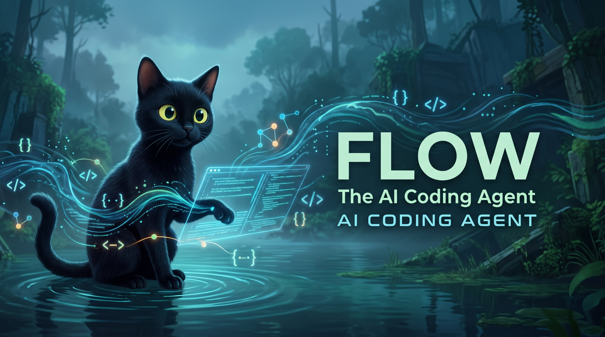
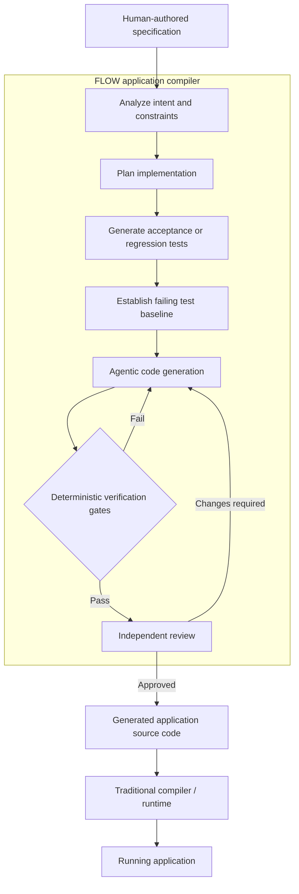

# FLOW

**Formal Language Orchestration Workflow**

**The application compiler for the agentic era.**

*Specify. Compile. Verify.*

## Vision: a new software development lifecycle

Software engineering has continually raised the level of abstraction at which humans express computational intent. Most programmers rarely inspect the assembly generated by a C compiler or the bytecode generated by a Java compiler. They author a higher-level representation of intent and rely on a toolchain to translate it into an executable representation.

Agentic engineering represents an opportunity to make a similar transition.

Rather than using AI simply to write code faster, FLOW explores a new software development lifecycle in which specifications become the primary source artifact, AI agents become code-generation engines, and application source code becomes a generated, inspectable artifact.

The engineer owns the intent, architecture, contracts, constraints and acceptance criteria. FLOW orchestrates implementation and verification. Conventional compilers and runtimes still turn the resulting source code into a running application.

The goal is not to eliminate code or prevent engineers from inspecting it. It is to make manual implementation less central to everyday engineering, while retaining accountability for correctness, security, performance and maintainability.

## The application compiler



FLOW combines probabilistic code generation with deterministic workflow control and verification gates. The language model is a component of the compiler, not the compiler itself. The model proposes implementations; independently executed tools provide evidence about whether those implementations satisfy the specification.

| Traditional compiler | FLOW application compiler |
| --- | --- |
| Source language | Application specification |
| Parsing and semantic analysis | Intent, requirements and constraint analysis |
| Intermediate representation | Implementation plan |
| Code generation | Agentic implementation |
| Optimization passes | Refactoring and performance improvement |
| Diagnostics | Test failures and review findings |
| Output | Application source code and verification evidence |

This is an architectural analogy, not a claim of equivalent formal guarantees. Natural-language specifications can be ambiguous, and passing tests does not establish complete correctness. Making specifications more precise and verification more comprehensive is central to the vision.

## FLOW today

The current implementation is a set of slash commands for Claude Code that takes a change from issue to pull request in seven gated steps. It is a practical foundation for the application compiler vision, not yet a general-purpose specification compiler.

The commands run the tests and keep the record; the agent reads and writes code; the engineer decides at each step.

- Tests are run by the tool, not reported by the agent. Only `/flow-verify`
  can say a change works.
- Each step refuses to run until the one before it is done.
- Progress is saved in the repository's `.git` directory, so `/flow-status`
  can always say where you are and what to type next.
- The review is done by a fresh agent that has not seen the session.

## Research direction

- **Specification as source:** Version-controlled specifications, executable contracts and constraints become first-class engineering artifacts.
- **Incremental compilation:** Specification changes trigger regeneration and verification of affected components rather than entire applications.
- **Traceability:** Implementation changes and verification evidence map back to requirements and architectural decisions.
- **Independent verification:** Extend acceptance and regression testing with security policies, performance budgets and architectural constraints.
- **Interchangeable backends:** Make code-generation models replaceable rather than coupling the application compiler to a single agent.
- **Specification-centric review:** Review changes in intent alongside the generated implementation and its verification evidence.

The long-term ambition is to make intent, rather than implementation, the primary unit of software engineering.

## Install

```
git clone https://github.com/funston/flow.git ~/flow
python3 ~/flow/install.py
```

Start a new Claude Code session and type `/flow-help`.

Needs Python 3.9+, git and Claude Code. The workflow itself uses only the
standard library.

| Optional | For |
| --- | --- |
| GitHub CLI (`gh`) | Opening and reviewing pull requests, GitHub issues |
| `LINEAR_API_KEY` in your shell profile | Listing and picking Linear issues |

The commands are read from the machine the agent runs on. When you work on a
remote host, install there too.

`install.py --dest DIR` writes the commands somewhere else (for example a
project's `.claude/commands`), `--uninstall` removes them. Files it did not
write are never touched.

## A bug

```
/flow-onboard            map the repo, record the test baseline
/flow-linear             list your Linear issues (or /flow-issue to list others)
/flow-issue ENG-142      branch, move the issue to In Progress, trace the cause
/flow-repro              ask for a regression test
/flow-repro <test id>    run it: it has to fail
/flow-fix                smallest correct fix
/flow-verify             regression test passes and nothing else broke
/flow-review             independent review of the diff
/flow-pr                 write the description; --create opens the pull request
```

## A feature

Write the spec in the issue first. It needs a list a test can check:

```
## Acceptance criteria
- export(rows) returns CSV text with a header row
- an empty list gives only the header
```

Then use `/flow-feature` instead of `/flow-issue`:

```
/flow-feature ENG-200    plan against the spec, no code; the plan is posted
                         to the Linear issue as a comment
/flow-repro              acceptance tests, one per criterion
/flow-repro <test id>    they have to fail: the feature does not exist yet
/flow-fix                build the smallest change that satisfies the spec
/flow-verify  /flow-review  /flow-pr      as for a bug
```

`/flow-repro` re-reads the issue and refuses to write tests until it has an
`Acceptance criteria` list. The reviewer checks the diff against the criteria
one by one.

## All commands

`/flow-help` lists them. Besides the steps above: `/flow-status`,
`/flow-scope` (work in one directory of a large repository), `/flow-prs`
(review someone else's pull request), `/flow-reset`, and prompt-only helpers
for steering the agent (`/flow-refocus`, `/flow-prove-it`, `/flow-trim-diff`,
`/flow-restore-test`, `/flow-explain-code`, `/flow-perf`).

## Layout

| Path | What |
| --- | --- |
| `bin/flow` | The command the slash commands call |
| `install.py` | Generates the 15 step commands into `~/.claude/commands`; each one calls `bin/flow` by its path on your machine, so they are written at install time and are not files in this repository |
| `helpers/` | The 6 prompt-only helpers (`/flow-refocus`, `/flow-prove-it`, ...), copied as they are |
| `src/flow/workflow.py` | The steps, gates and saved state |
| `src/flow/linear.py` | Linear, through its MCP server |
| `src/flow/flow_cli.py` | Command-line front end |
| `tests/` | Tests: real git repositories and real pytest runs |

## Tests

```
python3 -m pip install pytest mcp
python3 -m pytest tests -q
```
